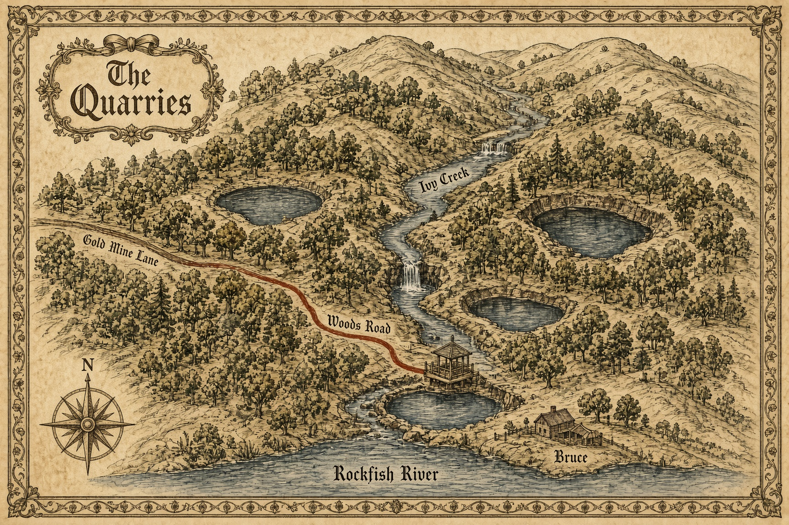
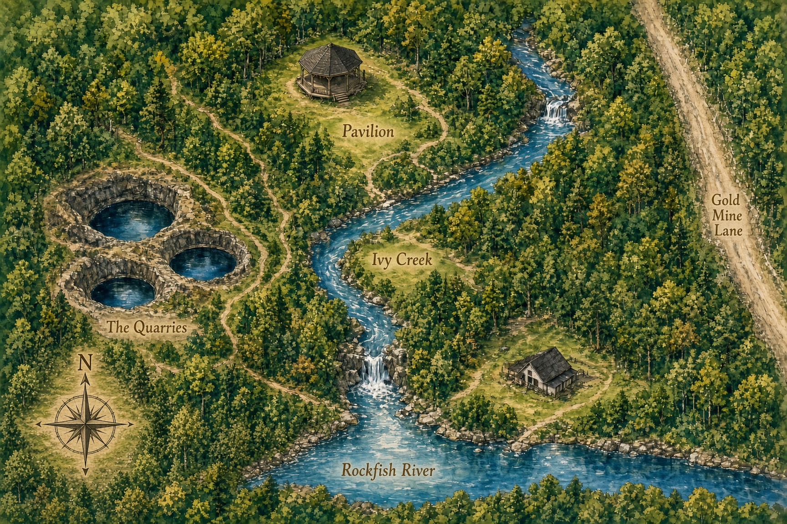
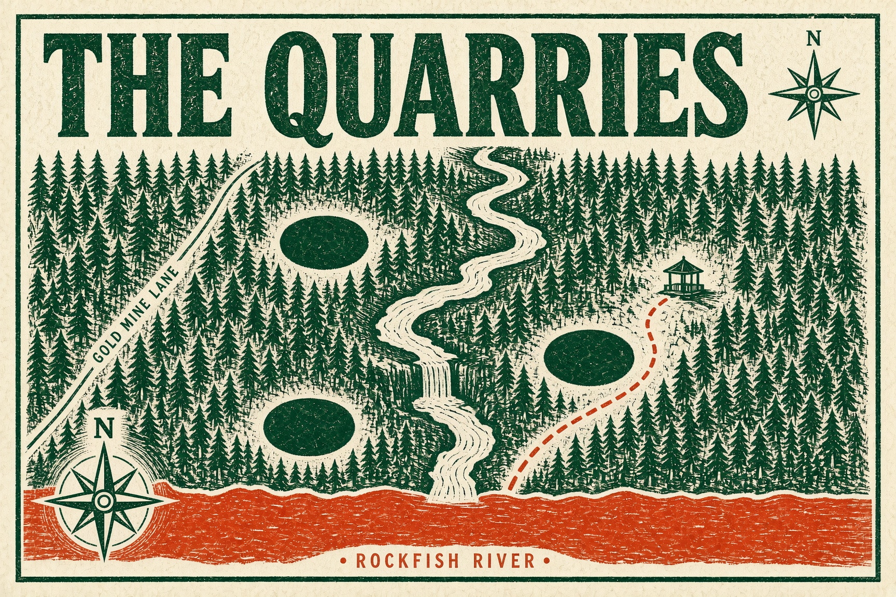
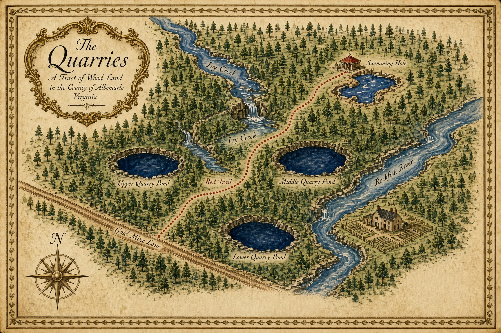
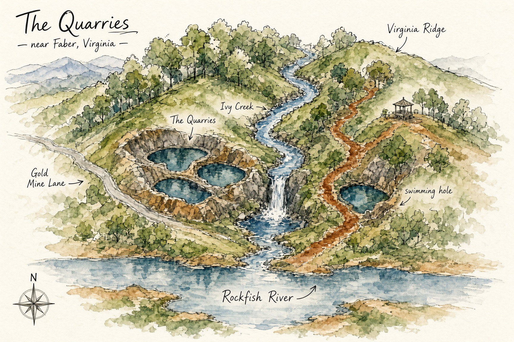

# Five drawn maps of the Quarries

Original drawings, not restyles of the survey sheet. North is up on every compass.

## 1. The parchment

Ink, little trees, and a red path, in the manner of an old story map.

## 2. The canopy

The woods drawn tree by tree, with the creek, the ponds, and the river.

## 3. The cut

A two-ink linocut. The trail and the Rockfish are the only red.

## 4. The estate sheet

A vellum plat painted with a stand of trees for the forest.

## 5. The field sketch

Loose ink and watercolor, as if drawn from the ridge.

