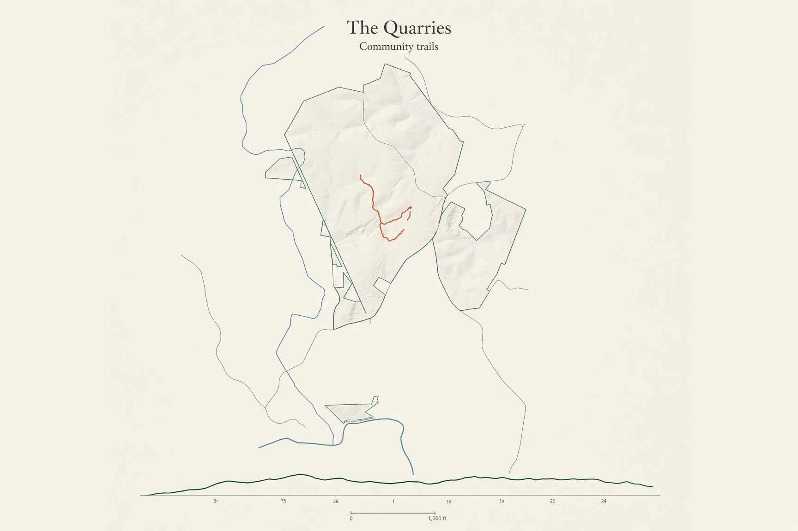
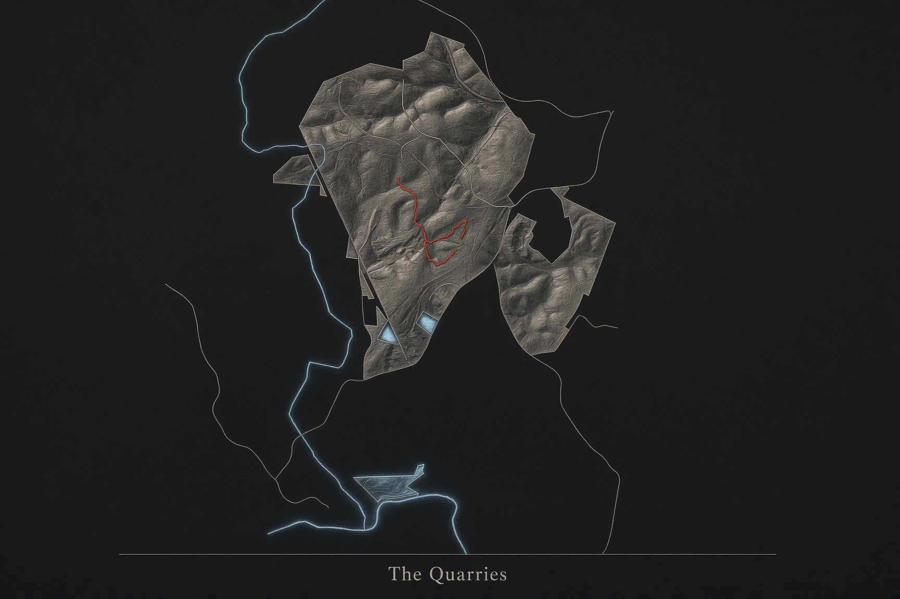
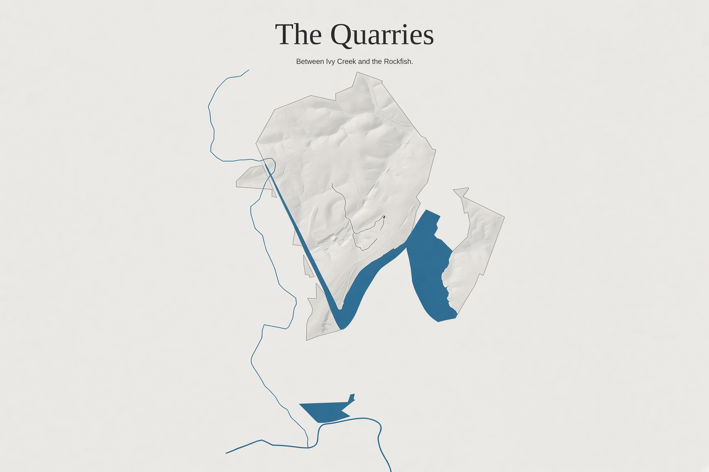
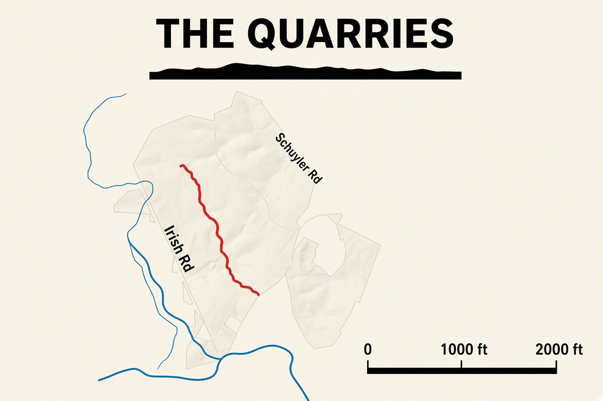
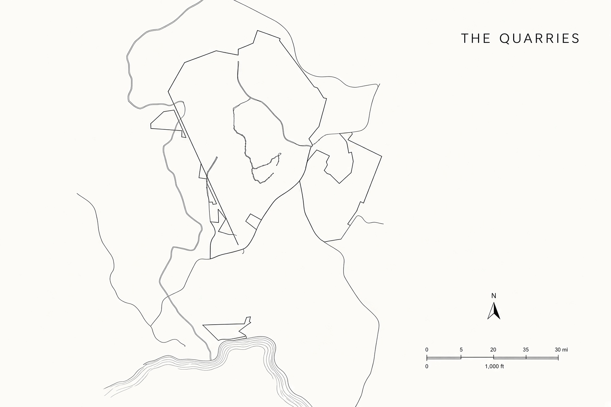

# Five ways to print the Quarries

Style studies of the same land. Not a new survey.

## 1. The Walk

Quiet sheet. The climb is drawn along the bottom.

## 2. Copperplate

A dark wall map. The trail is the only bright color.

## 3. Between the waters

The creek and the river are the subject.

## 4. Field card

Thick trail, solid water, a large scale in feet.

## 5. The plat

Hairline ink, drawn like a survey.

